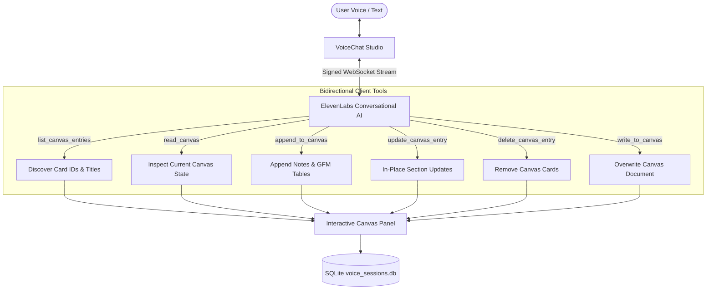

# 🎙️ ElevenLabs Voice Canvas Studio

An open-source, full-stack voice assistant studio powered by **ElevenLabs Conversational AI**, **React 19**, **Tailwind CSS**, **Hono**, and **SQLite**. Features real-time bidirectional WebSocket tool calling, interactive markdown/GFM table canvas, document context injection, and seamless session resumption.


---

## ✨ Features

- 🎙️ **Ultra-Low Latency Spoken Voice AI**: Powered by `@elevenlabs/react` with real-time waveform and responsive visualizer orb.
- 📋 **Bidirectional Interactive Canvas**:
  - **Live Tool Calling**: The voice agent reads, writes, updates, and deletes notes/sections directly on screen over active WebSockets.
  - **GFM Tables & Formatted Artifacts**: Native markdown table rendering (`| Col 1 | Col 2 |`), code blocks with copy buttons, collapsible `<details>`, and highlighted badges.
  - **User In-Place Editing**: Double-click or click the edit icon on any canvas card to edit markdown directly in the browser with live Save/Cancel.
- 🔁 **Lossless Session Resumption**:
  - Reconnects to past sessions and injects verbatim prior conversation turns directly into the voice agent's context memory via `sendContextualUpdate`.
  - Merges and saves coherent sessions without duplicate session fragmentation.
- 📄 **1000+ Word Document Context Injection**:
  - Paste large articles, resumes, or codebases directly into the voice assistant's active memory during calls.
- 💾 **Local-First SQLite Persistence**:
  - Stores all transcripts, durations, and canvas states in `voice_sessions.db` with WAL mode and local storage backups.
- 🎨 **Minimalist Obsidian Dark Theme**:
  - Linear/Raycast-inspired dark palette (`#09090b` zinc base), smooth transitions, custom scrollbars, and accessible controls.

---

## 🛠️ Architecture & Client Tools



---

## 🚀 Getting Started

### 1. Prerequisites
- [Bun](https://bun.sh/) (v1.0+) or Node.js (v18+)
- An [ElevenLabs](https://elevenlabs.io/) Account & API Key

### 2. Clone and Install Dependencies
```bash
git clone https://github.com/your-username/elevenlabs-voice-canvas.git
cd elevenlabs-voice-canvas
bun install
```

### 3. Configure Environment Variables
Copy `.env.example` to `.env`:
```bash
cp .env.example .env
```
Fill in your ElevenLabs credentials:
```env
ELEVENLABS_API_KEY=your_elevenlabs_api_key_here
ELEVENLABS_AGENT_ID=your_elevenlabs_agent_id_here
PORT=3002
```

### 4. Create or Sync Agent Client Tools
To automatically configure or sync your ElevenLabs agent with the required tool definitions and prompt guidelines:
```bash
bun run update-agent
```
Or create a fresh lean agent:
```bash
bun run create-agent
```

### 5. Start Development Server
```bash
bun run dev
```
Open **http://localhost:5173** in your browser.

---

## 📁 Project Structure

```
.
├── server/
│   ├── db.ts               # SQLite service (sessions, transcripts, canvas_json)
│   ├── index.ts            # Hono API backend (signed URLs, canvas sync, CRUD)
│   ├── createAgent.ts      # Automated ElevenLabs agent setup script
│   └── updateAgent.ts      # Cloud agent tool sync script
├── src/
│   ├── components/
│   │   ├── AvatarSpeaker.tsx  # Reactive orb visualizer
│   │   ├── CanvasPanel.tsx    # GFM table & in-place markdown canvas
│   │   ├── SessionHistory.tsx # History drawer with resume & search
│   │   ├── SettingsModal.tsx  # API key & Agent ID configuration
│   │   ├── VoiceChat.tsx      # Main workstation & ElevenLabs WebSocket client tools
│   │   └── Waveform.tsx       # Spectrum audio visualizer
│   ├── App.tsx             # Root layout & route hydration
│   └── index.css           # Zinc-950 obsidian design tokens & styles
├── .env.example
├── .gitignore
├── package.json
└── vite.config.ts
```

---

## 📜 Available Scripts

| Command | Description |
|---|---|
| `bun run dev` | Starts frontend Vite dev server and Hono backend concurrently |
| `bun run server` | Starts Hono backend server (`http://localhost:3002`) |
| `bun run build` | Builds frontend for production into `dist/` |
| `bun run update-agent` | Syncs bidirectional canvas tools to ElevenLabs agent |
| `bun run create-agent` | Creates a brand new lean agent on ElevenLabs |

---

## 📄 License
MIT License. Free for personal and commercial use.
